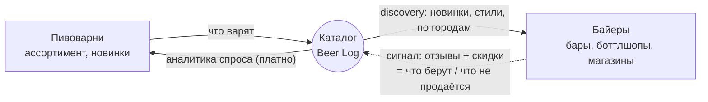

# MVP — финальный концепт Фазы 0

> Рассматривается реализация в режиме **ресёрч-проекта** (без продукта/монетизации) —
> вердикт и облегчённая спецификация в [[mvp-research-mode]]. Эта страница описывает
> продуктовый концепт; ресёрч-режим переиспользует то же ядро (сбор+каталог+петля).

## Суть одной фразой

Beer Log — не «ещё один каталог», а **петля обратной связи между двумя сторонами,
у которых сейчас прямой связи нет**:

- **Пивоварни → Байеры:** инфа о том, кто что варит и какие новинки (discovery).
- **Байеры → Пивоварни:** сигнал спроса — что реально берут, а что нет.

Каталог пивоварен и сортов — это субстрат, по которому течёт петля. Продукт — сама
петля и [[monetization|аналитика спроса]], которую она генерирует. Именно петлю не
закрывает никто из существующих ([[need-and-demand]]): РусБир/реестры — это витрины
и справочники без обратной связи, а Untappd закрывал её для потребителей и ушёл
([[untappd]]).

## Петля

## Ключевой трюк: сторону спроса бутстрапим из открытых данных

Обычная боль маркетплейса — «байеры не дают фидбек, пока их мало». Мы её обходим:
**обратную связь от байеров снимаем пассивно**, из публичных данных популярных
магазинов РФ, а не просим её активно:

- **Ассортимент и новинки** — парсинг [[telegram-sources|TG-каналов]] и сайтов
  магазинов/пивоварен ([[parser-architecture]]).
- **Сигнал спроса** — две пассивные метрики, читаемые без интервью
  ([[approach|build-to-learn]]):
  - **Скидки/уценки** на позиции = прокси «что плохо продаётся» (наблюдение по
    «Ваш Чехов», см. [[data-model]], `task-9`).
  - **Отзывы/популярность** позиций в крупных магазинах (2ГИС/Яндекс/витрины) =
    прокси «что берут».

То есть петля наблюдаема ещё до того, как у нас появится живой байер-аккаунт.

## Что входит в MVP Фазы 0 (и что НЕ входит)

Входит: каталог пивоварен/сортов из парсеров; нормализация и дедуп
([[data-model]]); discovery-витрина для байеров (фильтр по стилю/городу, поиск);
**инструментовка обеих сторон петли** — сбор сигнала спроса (скидки+отзывы) и
метрик поведения; заготовка теста готовности платить (paywall-заглушка аналитики).

Не входит: профили/онбординг пивоварен (Фаза 1), полноценная платная аналитика
(Фаза 2), заказы и ЕГАИС (Фаза 3). Публичной потребительской витрины и «рейтингов
для потребителя» не делаем — это регуляторный риск ([[risks]]); отзывы/скидки идут
во **внутренний** сигнал спроса, не в публичный рейтинг.

## Декомпозиция на блоки

1. **Сбор данных.** Парсеры TG + сайтов магазинов/пивоварен. Старт — TG
   ([[telegram-sources]]). Бэклог: `task-1`, `task-2`.
2. **Сигнал спроса.** Найти самые популярные магазины РФ, снимать их
   отзывы+скидки во времени как обратную связь байеров. Бэклог: `task-9`, `task-10`.
3. **Каталог и дедуп.** Хранилище (SQLite/bun:sqlite) + слияние сущностей.
   Бэклог: `task-3`.
4. **Витрина.** discovery для байеров на реальных данных. Бэклог: `task-4`.
5. **Инструментовка валидации.** Метрики discovery + paywall-тест готовности
   платить как фича ([[approach]]).
6. **Привлечение.** [[promotion-phase0|Контент-движок]]: TG-канал + автодайджесты.
   Бэклог: `task-6`.

## Критический путь

`task-1` → `task-2` → `task-3` → `task-4`, параллельно `task-9`/`task-10`
(сигнал спроса) и `task-5` ([[parser-architecture|самовосстановление]]).

## Метрики выхода из Фазы 0

1. **Discovery работает:** ≥ 50 уникальных байеров и заметные возвраты.
2. **Петля наблюдаема:** по ≥ N позициям видно и ассортимент, и сигнал спроса
   (скидки/отзывы) во времени — т.е. есть что показать пивоварне.
3. **Есть проблеск готовности платить:** клики/предоплаты на paywall-заглушке.

Закрыли — переходим к [[phases|Фазе 1]] (онбординг пивоварен) и Фазе 2 (включаем
аналитику как платный продукт).

## Честные оговорки

- Отзывы магазинов — это в основном *потребительский* сигнал, шумный прокси B2B-
  спроса; скидки чище, но тоже шумят (бывают промо/сток/срок годности). Лечится
  накоплением истории и кросс-проверкой нескольких сигналов.
- Петля ценна, но не отменяет рыночные риски ([[need-and-demand]], [[market]]):
  рынок −16,7%, платящая сторона беднеет. Поэтому прибыль — не на старте
  ([[approach]]), но архитектуру под монетизацию закладываем сразу.

Связано: [[need-and-demand]], [[approach]], [[data-model]], [[parser-architecture]], [[monetization]], [[phases]], [[promotion-phase0]], [[hybrid-shop-bar]].
